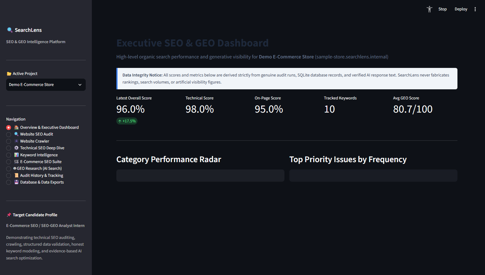
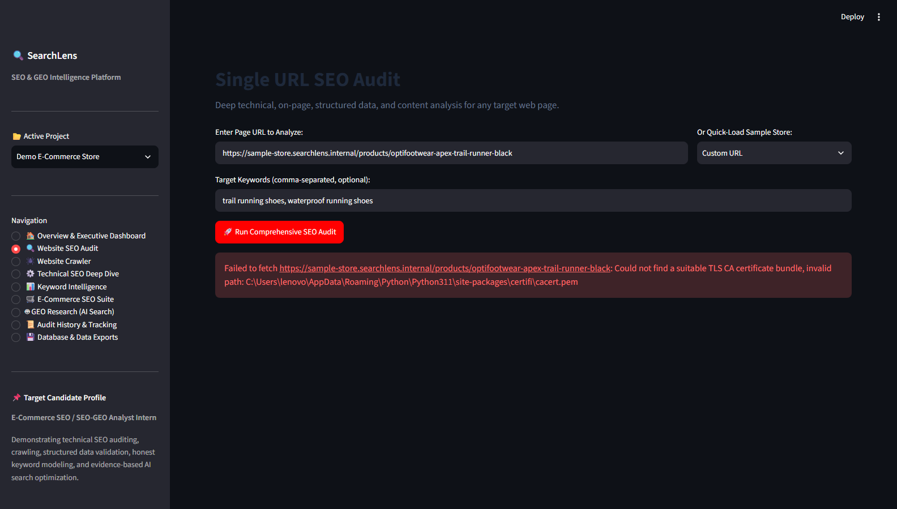
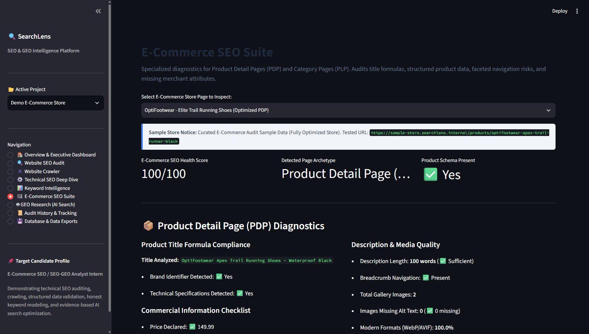
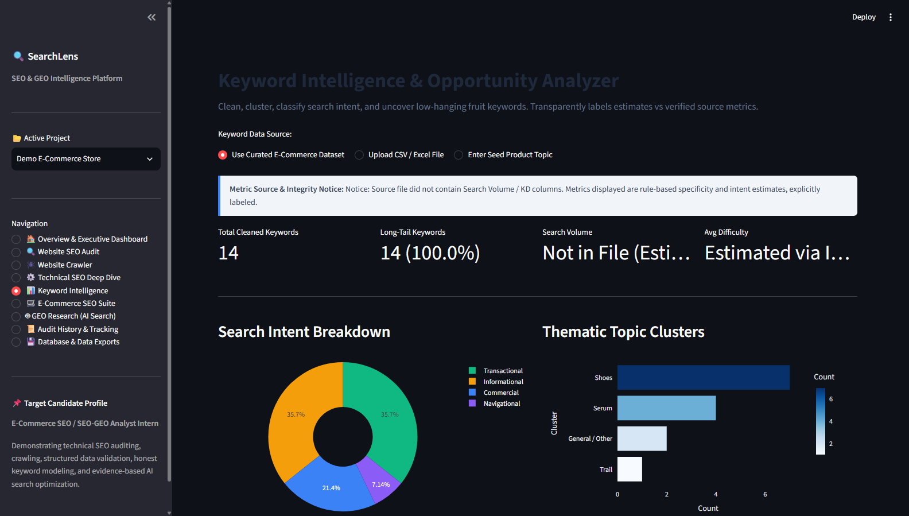
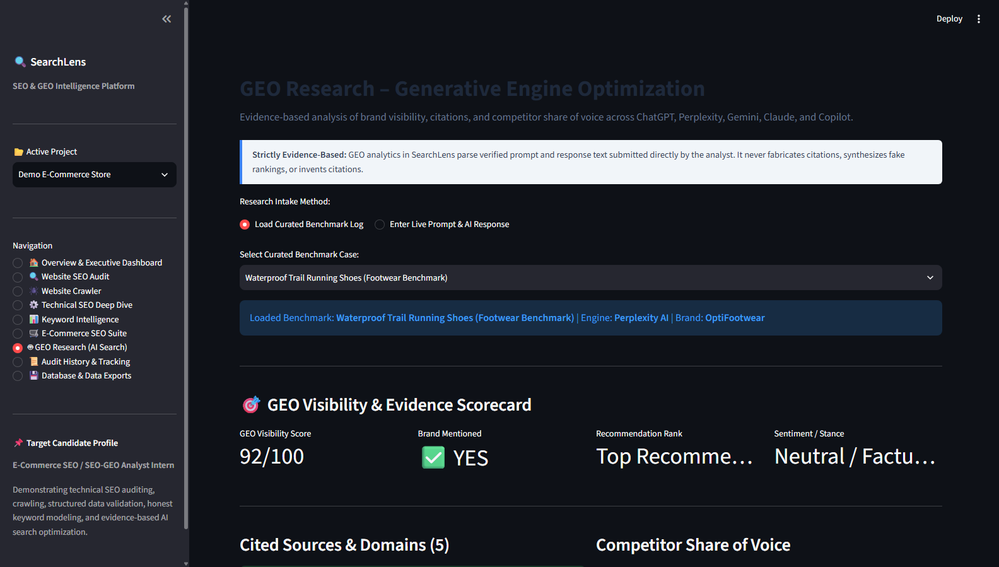

# SearchLens – SEO & GEO Intelligence Platform

[](https://www.python.org/downloads/)
[](https://opensource.org/licenses/MIT)
[](https://streamlit.io/)
[]()

---

## Executive Summary

SearchLens is an end-to-end SEO and Generative Engine Optimization (GEO) platform architected for modern search landscapes. As search expands from traditional search engine result pages (SERPs) into artificial intelligence answer engines (ChatGPT Search, Perplexity AI, Google AI Overviews), organic search analysts require tools that audit both classical crawler fundamentals and generative brand visibility.

SearchLens unifies:
1. Technical and On-Page SEO Auditing (Schema.org JSON-LD, crawlability, indexability, HTTP status codes, canonicals, robots.txt, and XML sitemaps).
2. E-Commerce Specific Diagnostics (Product Detail Page and Category Page auditing, title formula evaluation, missing commercial attributes, image alt text, and faceted navigation duplicate risks).
3. Keyword Intelligence and Opportunity Modeling (search intent classification, long-tail query extraction, thematic topic clustering, and honest metric transparency).
4. Generative Engine Optimization (GEO) Research (evidence-based prompt-response tracking, citation domain attribution, and competitor share-of-voice across AI engines without synthetic hallucination).
5. Relational SQLite Database and Data Analytics (historical tracking, multi-audit comparisons, issue trends, and bulk CSV/JSON data exports).
6. Interactive Streamlit Dashboard with real-time analytics, responsive charts, and an intuitive UI.

---

## Platform Interface and Screenshots

### Executive Overview and Health Dashboard
High-level KPI cards, category performance radar, issue frequency distribution, and recent audit diffs.



---

### Single URL Deep SEO Audit
Detailed single-URL audit with category scores, actionable issue accordions (severity, explanation, fix), on-page signal inspection, and JSON-LD structured data testing.



---

### E-Commerce SEO Suite
Specialized PDP and PLP store diagnostics, product title formula checks, commercial attributes checklist (price, currency, availability, SKU, reviews), and faceted navigation duplicate content risk detection.



---

### Keyword Intelligence and Opportunity Matrix
Keyword dataset processing, search intent breakdown (Transactional, Commercial, Informational, Navigational), thematic topic clustering, and opportunity score modeling.



---

### GEO Research (AI Search Optimization)
Evidence-based Generative Engine Optimization tracker for ChatGPT, Perplexity, Gemini, Claude, and Copilot. Isolates brand recommendations, sentiment stance, cited domain sources, and competitor share-of-voice.



---

## Architecture and System Design

```
searchlens-seo-geo/
|-- app.py                      # Classical CLI & Flask REST API entry point
|-- dashboard.py                # Comprehensive Streamlit 9-section UI Dashboard
|-- streamlit_app.py            # Streamlit Cloud deployment entry point
|-- searchlens.db               # SQLite Relational Database (auto-initialized & seeded)
|-- requirements.txt            # Dependency manifest
|-- LICENSE                     # Original MIT License (Huzaifa Shoukat)
|-- README.md                   # Full documentation & usage guide
|
|-- assets/
|   `-- screenshots/            # Verified application interface captures
|
|-- scripts/
|   `-- take_screenshots.py     # Automated browser screenshot generation script
|
|-- modules/                    # Core Modular Architecture
|   |-- on_page/                # On-page elements (titles, meta, headings, images, links)
|   |-- technical/              # Technical SEO (network, HTML core, metrics, site checks)
|   |   `-- structured_data.py  # Rich Schema.org validator (Product, Breadcrumbs, FAQ, Article)
|   |-- content/                # Content quality (readability, text-to-html ratio, spellcheck)
|   |-- scoring/                # Unified weighted scoring module
|   |-- site_audit/             # Multi-threaded crawler, duplication detection, CSV exports
|   |   `-- issues.py           # Structured issues model with severity, explanation & fix
|   |-- ecommerce/              # E-Commerce SEO Suite
|   |   |-- analyzer.py         # PDP & PLP auditor, title formula, faceted risk checks
|   |   `-- sample_stores.py    # Curated sample e-commerce stores (OptiFootwear, LuxeGlow, PeakGear)
|   |-- keywords/               # Keyword Intelligence & Clustering
|   |   `-- processor.py        # Dataset cleaner, intent classification, opportunity score, suggestions
|   |-- geo/                    # Generative Engine Optimization (GEO)
|   |   `-- tracker.py          # Evidence-based AI search parser, citations extractor, competitor SOV
|   `-- storage/                # SQLite Relational Storage
|       |-- db.py               # Database manager, schema migrations, analytical queries, CSV/JSON
|       `-- seed.py             # Portfolio benchmark seed utility
|
`-- tests/                      # Automated Test Suite (25 Unit & Integration Tests)
    |-- test_on_page.py
    |-- test_technical_and_schema.py
    |-- test_crawler_and_site_audit.py
    |-- test_keywords.py
    |-- test_ecommerce.py
    `-- test_geo_and_storage.py
```

---

## Key Capabilities

### 1. Technical SEO Auditing
- Title and Meta Description: Checks length (characters and pixel approximations), duplicate word counts, power words, and primary keyword presence.
- Heading Hierarchy: Enforces clean semantic outlines ($H_1 \to H_2 \to H_3$); identifies missing or multiple $H_1$ elements.
- Indexability and Directives: Inspects `meta robots` (`noindex`, `nofollow`), `X-Robots-Tag` HTTP response headers, and canonical tag configurations.
- Canonical Auditing: Detects missing canonicals, cross-protocol canonicals (HTTP to HTTPS), self-referencing canonicals, and broken canonical targets.
- Structured Data Validator: Validates JSON-LD Schema.org types (`Product`, `Offer`, `BreadcrumbList`, `Organization`, `FAQPage`, `Article`); validates required versus recommended properties and rich result eligibility.
- Robots.txt and Sitemap Discovery: Parses disallow directives line-by-line, identifies crawl blockages, and discovers XML sitemaps.

### 2. Website Crawler and Site Audit
- Safe crawling with configurable page caps (default: 15 to 50 pages) and max depth parameters (1 to 4).
- Internal versus external link discovery, HTTP status distribution (200, 3xx, 4xx, 5xx), and redirect loop and chain detection.
- Content duplication detection via `visibleTextHash` and title grouping across crawled pages.
- Every discovered issue includes:
  - Affected URL
  - Issue Code and Category
  - Severity (`error`, `warning`, `notice`)
  - Root Cause Explanation
  - Actionable Step-by-Step Fix

### 3. Keyword Intelligence and Intent Classification
- Supports CSV and Excel (`.xlsx`, `.xls`) file uploads, seed lists, or curated e-commerce datasets.
- Automatic text cleaning, deduplication, and tokenization.
- Search Intent Classifier: Categorizes queries into Transactional, Commercial, Informational, or Navigational with confidence scores.
- Long-Tail Keyword Identification: Queries with 3 or more words or intent-rich modifiers.
- Thematic Topic Clustering: Groups keywords by semantic modifiers and parent product categories.
- Opportunity Score Formula (0 to 100):
  $$\text{Opportunity} = \text{Volume Score} (0-50) + \text{Difficulty Score} (0-40) + \text{Intent Bonus} (0-10)$$
- Strict Metric Honesty: If source files omit search volume or difficulty, SearchLens explicitly tags scores as `Estimated via Query Specificity & Intent (Search Volume/KD Not In Source Data)` rather than fabricating numbers.

### 4. E-Commerce SEO Suite
- Page archetype classifier: PDP (Product Detail Page) versus PLP (Category Listing) versus General content page.
- PDP Checks:
  - Title formula check: `[Brand] + [Product/Model] + [Key Feature] + [Variant/Specs]`.
  - Description depth: Flags thin descriptions under 100 words.
  - Missing commercial attributes: Price, ISO 4217 Currency, Availability/Stock, SKU, and AggregateRating review stars.
  - Media audit: Product images missing descriptive alt text, responsive sizing, and modern WebP/AVIF format checks.
  - Breadcrumb navigation verification.
- PLP Checks: Category introductory copy depth, product card counts, and pagination tags.
- Faceted Navigation Risk: Flags filtered query parameters (`?color=`, `?sort=`, `?size=`) that lack canonical tags pointing to root category pages.

### 5. Generative Engine Optimization (GEO) Research
- Tracks and measures brand visibility across AI answer engines: ChatGPT (GPT-4o Search), Perplexity AI, Google AI Overviews / Gemini, Claude, and Microsoft Copilot.
- Evidence-based prompt and response parser:
  - Brand and Product Mention Detection: Measures frequency, sentiment (Positive/Endorsed, Neutral, Critical), and position rank (Top Recommendation vs Comparative vs Not Mentioned).
  - Citation and Domain Attribution Extractor: Identifies all hyperlinks and bare URLs cited by the AI model; checks if the brand's own domain was referenced as an authoritative source.
  - Competitor Share of Voice: Identifies competing brands cited in the same answer and logs their order of appearance.
  - Zero Fabrication: Verified evidence logging with honest disclosures.

### 6. Relational SQLite Database and Data Analytics
- Seven relational tables: `projects`, `crawled_pages`, `audit_results`, `seo_issues`, `keywords`, `geo_research`, `audit_history`.
- Built-in SQL analytical queries:
  - Most common issues by category and severity
  - Most affected pages with issue severity breakdowns
  - Multi-audit comparison (score delta and progress tracking)
  - Keyword opportunity ranking
  - Cross-platform AI engine comparison
- One-click bulk exports to CSV and JSON for every table.

---

## Dashboard Navigation

The platform features a 9-view responsive dashboard:

| View | Purpose |
|------|---------|
| Overview & Executive Dashboard | High-level KPI cards, category performance radar, issue frequency chart, and recent audit diffs. |
| Website SEO Audit | Deep single-URL audit with visual gauges, issue accordions, on-page inspect, and JSON-LD schema testing. |
| Website Crawler | Multi-page crawler with live progress bars, internal link table, duplicate alerts, and CSV exports. |
| Technical SEO Deep Dive | Standalone tools for robots.txt analysis, sitemap health inspection, redirect hops, and schema validation. |
| Keyword Intelligence | File uploader, intent pie chart, cluster bar charts, opportunity matrix, and seed suggestions generator. |
| E-Commerce SEO Suite | Audits PDP and PLP store pages, title formula compliance, missing attributes, and faceted duplicate risks. |
| GEO Research (AI Search) | Prompt-response parser, brand visibility score, citation domains, and competitor share-of-voice charts. |
| Audit History & Tracking | Historical score trend lines over time and comparative delta audit reports. |
| Database & Data Exports | Relational table inspector and one-click bulk CSV / JSON data downloads. |

---

## Quick Start and Installation

### Prerequisites
- Python 3.11 or higher
- Git

### Installation Steps

1. Clone the repository:
   ```bash
   git clone https://github.com/Taniiie/searchlens-seo-geo.git
   cd searchlens-seo-geo
   ```

2. Create and activate a virtual environment:
   ```bash
   # Windows PowerShell
   python -m venv venv
   .\venv\Scripts\Activate.ps1

   # macOS / Linux
   python3 -m venv venv
   source venv/bin/activate
   ```

3. Install dependencies:
   ```bash
   pip install -r requirements.txt
   ```

4. Launch the Streamlit Dashboard:
   ```bash
   streamlit run dashboard.py
   # or
   streamlit run streamlit_app.py
   ```
   Open your browser to `http://localhost:8501`.

5. (Optional) Run classical CLI audit:
   ```bash
   python app.py https://example.com --keywords "ecommerce shoes"
   ```

---

## Automated Testing

SearchLens includes a complete unit and integration test suite with 25 passing test cases:

```bash
python -m pytest -v
```

### Test Coverage Summary:
- `tests/test_on_page.py`: Title length/pixels/keywords, meta descriptions, heading order, image alt text, Flesch reading ease, text-to-HTML ratio.
- `tests/test_technical_and_schema.py`: Doctype, charset, viewport, canonicals, robots meta, valid Product schema, missing offers/price detection, BreadcrumbList validation.
- `tests/test_crawler_and_site_audit.py`: URL normalization, duplicate content hashing, issue derivation with severity, explanation, and recommended fix.
- `tests/test_keywords.py`: Intent classification, long-tail query filtering, opportunity score modeling, clustering, and e-commerce suggestions.
- `tests/test_ecommerce.py`: PDP vs PLP detection, title formula check, missing SKU/availability/price, faceted self-canonicals, sample store audits.
- `tests/test_geo_and_storage.py`: Citation extraction, brand mention parsing, competitor share of voice, SQLite CRUD lifecycle, and CSV/JSON exports.

---

## Limitations and Future Work

- Live AI Query Execution: Current GEO tracking relies on recorded prompt-response logs (or curated benchmarks). Future work includes integrating authenticated API connections (e.g. Perplexity API, OpenAI API) to automate real-time query sweeps.
- Headless Browser Rendering: The crawler includes optional Playwright JS discovery for single pages; expanding distributed headless rendering across full multi-thousand page enterprise crawls is planned.
- Log File Analysis: Integrating web server access logs (Apache/Nginx/Cloudflare) to cross-reference bot crawl frequency against indexed URLs.

---

## Attribution and License

- License: [MIT License](LICENSE)
- Original Foundation: Inherited and extended from the [Advanced SEO Analyzer](https://github.com/Huzaifa-coder/advanced-seo-analyzer) created by Huzaifa Shoukat (Copyright (c) 2025 Huzaifa Shoukat).
- Transformations and Extensions: All E-Commerce SEO modules, Generative Engine Optimization (GEO) tracking, Keyword Intelligence processor, SQLite storage engine, test suite, and the Streamlit dashboard were engineered specifically for SearchLens – SEO & GEO Intelligence Platform.
